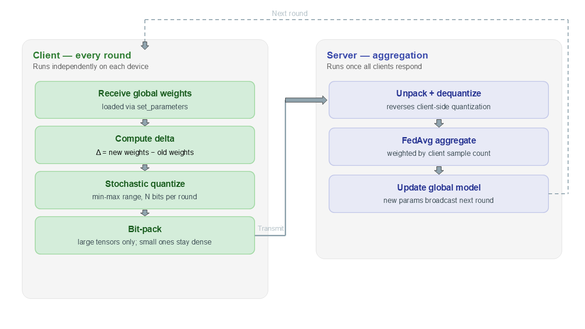

# Fed-CAUQ: Communication-Efficient Federated Human Activity Recognition

**Fed-CAUQ (Federated Cosine-Annealed Uniform Quantization)** is a communication-efficient compression scheme for federated learning, specifically evaluated on human activity recognition (HAR) using wearable inertial sensors. It cuts the data uploaded by clients by approximately **15x** while remaining within **0.2 percentage points** of uncompressed baseline accuracy.

---

## Overview

In federated learning, edge devices collaboratively train a shared model without transmitting raw sensitive data. However, uploading full model updates across numerous communication rounds frequently creates a massive bandwidth bottleneck. Fed-CAUQ systematically mitigates this overhead through four core principles:

<p align="center">
  
</p>

1. **Delta Updates:** Clients compress and transmit only the parameter changes (\(\Delta w = w*{new} - w*{global}\)) rather than full model weights.
2. **Stochastic Uniform Quantization:** Each tensor is dynamically quantized inside its own specific scalar range using unbiased stochastic rounding.
3. **Cosine Bit-Width Schedule:** Update precision is smoothly decayed across training rounds (e.g., transitioning from 3 bits to 2 bits, down to 1 bit) following a cosine annealing curve.
4. **Sub-Byte Bit-Packing:** Low-precision \(b\)-bit integer codes are tightly bit-packed into standard bytes so the physical transmission footprint matches the theoretical bit-width.

Because every single coordinate is structurally retained, this method completely eliminates the need to transmit positional or sparsity metadata.

---

## Main Results

- **Benchmark Setup:** WISDM dataset, 18 activity classes, IMU Transformer architecture, 3 IID clients, 70 communication rounds, random seed 42.

| Method                    |  Accuracy  |  Total Sent  | Compression |
| :------------------------ | :--------: | :----------: | :---------: |
| **FP32 (dense baseline)** |   80.43%   |  1289.03 MB  |    1.0x     |
| **FP16**                  |   80.22%   |  644.49 MB   |    2.0x     |
| **INT8**                  |   74.23%   |  322.28 MB   |    4.0x     |
| **Fed-CVLC**              |   79.41%   |  141.29 MB   |    9.1x     |
| **FedZip**                |   71.52%   |   45.93 MB   |    28.1x    |
| **Fed-CAUQ (Ours)**       | **80.27%** | **85.67 MB** |  **15.0x**  |

---

## Repository Structure

```text
.
├── data/              # Dataset downloading, structural partitioning, and preprocessing
├── models/            # Core IMU Transformer neural network architecture
├── flw_har.py       # Implementation of Fed-CAUQ
├── results/           # Target directory for generated visualization figures
└── README.md          # Project documentation
```

---

## Setup

```bash
# Clone the repository
git clone https://github.com/Showrup1005/har-with-imu-transformer-main.git

# Install required dependencies
pip install -r requirements.txt
```

---

## Dataset & Preprocessing

The project utilizes the **WISDM Smartphone and Smartwatch Activity and Biometrics Dataset** (comprising 51 subjects, 18 distinct activity classes, gathered via accelerometer and gyroscope streams).

### Feature Pipeline

- **Signal Expansion:** Raw 6-channel sensor inputs are expanded to **11 features per time step** by computing 2 signal magnitudes and 3 directional jerk components.
- **Validation Split:** Chronological data segmentation per `(subject, activity)` block allocates an **80% training** and **20% testing** split.
- **Normalization:** Standard Z-score normalization scaling parameters are extracted exclusively from training data statistics to guard against data leakage.

---

## Running the Experiment

```bash
# Run our proposed Fed-CAUQ compression pipeline
python flw_har.py
```

---

## Hyperparameter Configuration

| Setting                | Value                                                                                        |
| :--------------------- | :------------------------------------------------------------------------------------------- |
| **Client Count**       | 3 Clients (IID default; Dirichlet $\alpha = 0.3$ configured for non-IID setups)              |
| **Total Rounds**       | 70 global communication rounds                                                               |
| **Local Epochs**       | 5 internal epochs per client per round                                                       |
| **Optimizer**          | Adam (Learning Rate: `1e-4`, Weight Decay: `1e-4`)                                           |
| **Batch Size**         | 128                                                                                          |
| **Bit-Width Schedule** | Cosine annealed scaling from 3.0 down to 0.5 bits (rounded to discrete 3 / 2 / 1 thresholds) |
